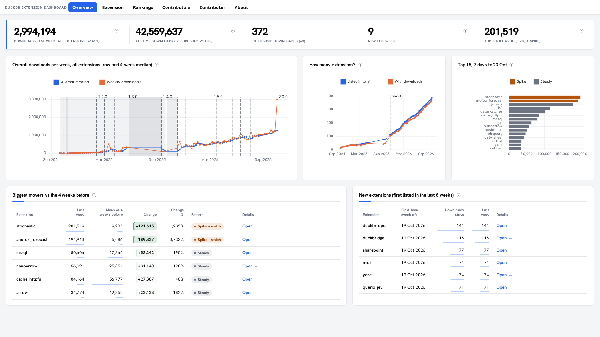
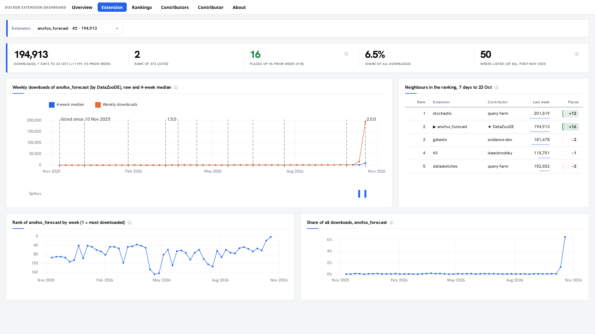
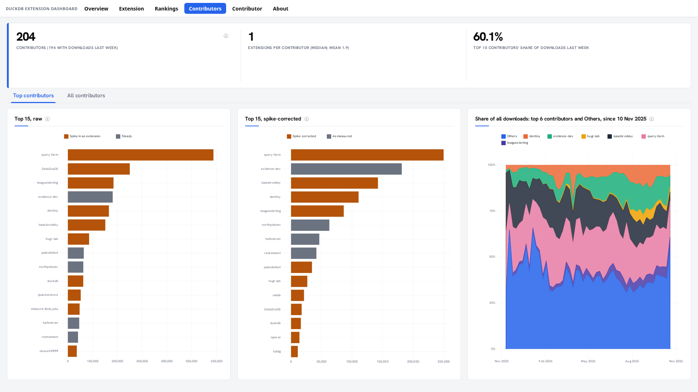
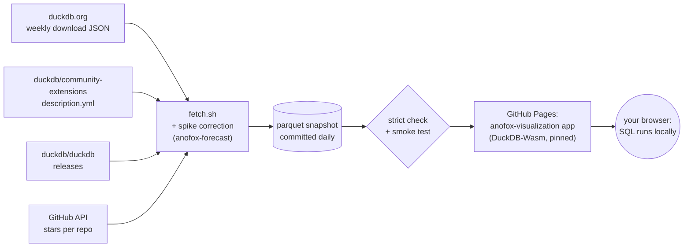

<div align="center">

# DuckDB Extension Dashboard

**How the DuckDB community-extension ecosystem is actually used: downloads, rankings, contributors, spikes and releases, every week.**

[](https://datazoode.github.io/duckdb-extension-dashboard/)

[](https://github.com/DataZooDE/duckdb-extension-dashboard/actions/workflows/update.yml)
[](https://github.com/DataZooDE/duckdb-extension-dashboard/actions/workflows/ci.yml)
[](https://github.com/DataZooDE/anofox-visualization)
[](LICENSE)

<a href="https://datazoode.github.io/duckdb-extension-dashboard/"></a>

</div>

## What you get

- **Community vs core:** DuckDB's own extensions (httpfs, json, …) next to the community ones, week by week; community is about a tenth of all extension downloads and grows faster.
- **The whole ecosystem at a glance:** about 3 million installs a week across more than 370 extensions, with every DuckDB release marked on the timeline.
- **Any extension in depth:** weekly downloads with the extension's own releases marked, rank over time, share of all installs, a maintenance card (built for the current DuckDB? last commit, last release, open issues), its neighbours in the ranking, and a side-by-side comparison with any other extension. Pick one from the dropdown, live in your browser.
- **Who builds DuckDB's extensions:** more than 200 contributors, ranked, with the top 15 shown raw and spike-corrected side by side.
- **Stars vs downloads:** every extension repo's GitHub stars against its usage. Stars explain only about a tenth of the spread in downloads, and the page lists the extensions used far more, or far less, than their stars suggest.
- **Releases vs downloads:** every extension's community releases, from the history of duckdb/community-extensions. Extensions with a release in the last 90 days have about twice the downloads, and downloads rise more after a release than in other weeks.
- **Honest numbers:** one-off spikes (CI or bot traffic) are flagged and corrected with a Hampel filter. Real growth is kept, confirmed by [anofox-forecast](https://github.com/DataZooDE/anofox-forecast)'s changepoint detection. Missing weeks show as gaps, never as zeros.
- **Always current:** a GitHub Action fetches the data daily, checks every dashboard, and republishes.

<table>
<tr>
<td width="50%"><a href="https://datazoode.github.io/duckdb-extension-dashboard/d/extension/?v.extension=anofox_forecast"></a><br><sub><b>Extension</b>: one extension, live, picked from a dropdown</sub></td>
<td width="50%"><a href="https://datazoode.github.io/duckdb-extension-dashboard/d/contributors/"></a><br><sub><b>Contributors</b>: who builds the ecosystem, raw vs spike-corrected</sub></td>
</tr>
</table>

## The pages

| Page | Question it answers | SQL |
|---|---|---|
| [Overview](https://datazoode.github.io/duckdb-extension-dashboard/) | Is the ecosystem growing, and what's hot? | [`overview.sql`](extension-downloads/overview.sql) |
| [Rankings](https://datazoode.github.io/duckdb-extension-dashboard/d/rankings/) | Where does every extension stand, and what is trending? Search by name or description. | [`rankings.sql`](extension-downloads/rankings.sql) |
| [Extension](https://datazoode.github.io/duckdb-extension-dashboard/d/extension/) | How is one extension doing? | [`extension.sql`](extension-downloads/extension.sql) |
| [Contributors](https://datazoode.github.io/duckdb-extension-dashboard/d/contributors/) | Who builds the ecosystem? | [`contributors.sql`](extension-downloads/contributors.sql) |
| [Contributor](https://datazoode.github.io/duckdb-extension-dashboard/d/contributor/) | How is one contributor doing vs everyone else? | [`contributor.sql`](extension-downloads/contributor.sql) |
| [Stars & releases](https://datazoode.github.io/duckdb-extension-dashboard/d/stars/) | Do stars and releases go with downloads? | [`stars.sql`](extension-downloads/stars.sql) |
| [About](https://datazoode.github.io/duckdb-extension-dashboard/d/about/) | Who made this, and how current is the data? | [`about.sql`](extension-downloads/about.sql) |

Every page is **one plain SQL file**. Charts, KPIs, tables and pickers are SQL
columns with a role (`downloads::LINECHART`, `'Top 15'::TITLE`, …), rendered by
[anofox-visualization](https://github.com/DataZooDE/anofox-visualization).

## How it works



There's no server: the site ships anofox-visualization's in-browser app, built
from the pinned release, next to the parquet snapshot. Your browser runs each
dashboard's SQL in DuckDB-Wasm, so the pickers re-query instantly.
[`update.yml`](.github/workflows/update.yml) runs daily at 06:30 UTC:

1. **Fetch:** download the metrics, extension metadata and release history, DuckDB releases and GitHub stars, and add the spike correction.
2. **Check:** every dashboard passes `dashboard --check --strict` and a locked-server smoke test on the fresh data.
3. **Commit:** the snapshot is committed if it changed, so the git log doubles as the data's history.
4. **Publish:** build the app from the pinned tag and deploy the site.

Any failure stops the run before anything is published, so the live site keeps the last good data.

## The data

| | Source | Note |
|---|---|---|
| Downloads | [DuckDB's download metrics](https://duckdb.org/community_extensions/download_metrics) | Cloudflare's estimate of `INSTALL` downloads, all platforms and versions together, per week |
| Core extension downloads | the same files on `extensions.duckdb.org` | DuckDB's own extensions, from 2025-W39 (continuous from 2025-12-01) |
| Extensions and contributors | [duckdb/community-extensions](https://github.com/duckdb/community-extensions) | contributor = the GitHub owner of the extension's repository |
| Extension releases | the history of each `description.yml` in [duckdb/community-extensions](https://github.com/duckdb/community-extensions) | a release = a new pinned commit (`repo.ref`) merged on main; DuckDB-team bulk updates are kept apart |
| DuckDB releases | [duckdb/duckdb](https://github.com/duckdb/duckdb/releases) | prereleases excluded |
| GitHub stars and maintenance | GitHub's GraphQL API, each extension's `repo.github` (stars, forks, open issues, last commit) | one snapshot per daily fetch, from 2026-10-30 (GitHub has no star history for other people's repos) |

Things to keep in mind:
- Until **2025-11-10** the site listed only about the top 50 extensions.
- The latest week is often a mid-week capture.

Details and caveats: [PROVENANCE.md](extension-downloads/demo/PROVENANCE.md).
Download the snapshot: [`data/`](https://datazoode.github.io/duckdb-extension-dashboard/data/meta.json).

## Run it yourself

```sh
scripts/fetch-tools.sh --blueprint extension-downloads    # pinned anofox-visualization CLI + DuckDB extension
extension-downloads/scripts/ci.sh                          # snapshot -> data/, strict check, smoke test
scripts/serve-locked.sh --blueprint extension-downloads --port 8828   # a locked server: http://127.0.0.1:8828/
extension-downloads/scripts/fetch.sh --out extension-downloads/demo   # refresh the data from the live sources
```

The published site is anofox-visualization's own `dashboard --site` output (the
pinned release's prebuilt web app, the dashboards and the data), built by
[`scripts/build-site.sh`](scripts/build-site.sh). To see exactly what will be
published, under the same `/duckdb-extension-dashboard/` sub-path as GitHub Pages:

```sh
scripts/preview.sh    # build the site, serve http://127.0.0.1:8104/duckdb-extension-dashboard/
```

## Made by

**Simon Müller** at [DataZoo](https://github.com/DataZooDE), the makers of the
anofox DuckDB extensions: [anofox-forecast](https://github.com/DataZooDE/anofox-forecast),
[anofox-statistics](https://github.com/DataZooDE/anofox-statistics) and
[anofox-visualization](https://github.com/DataZooDE/anofox-visualization).

Code: MIT ([LICENSE](LICENSE)). Data: DuckDB's public download metrics and
the community-extensions repository, see [PROVENANCE.md](extension-downloads/demo/PROVENANCE.md).
